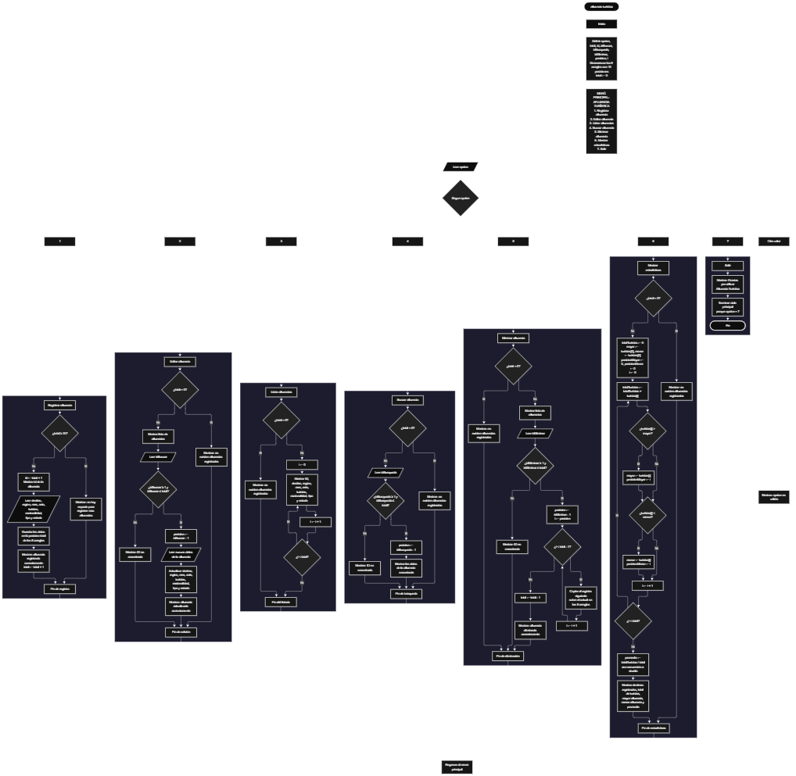

Este proyecto, llamado <b>afluencia turística</b>, fue desarrollado en <b>java</b> como un ejercicio práctico para fortalecer la lógica de programación mediante la creación de un sistema de gestión de afluencias turísticas desde la consola. El programa cuenta con un menú principal de siete opciones que permite <b>registrar, editar, listar, buscar, eliminar y consultar estadísticas</b> de las afluencias registradas. Cada afluencia almacena datos como el destino turístico, la ciudad o región, el mes, el año, la cantidad de turistas, la nacionalidad predominante, el tipo de turismo y el estado del destino, utilizando arreglos con una capacidad máxima de <b>10 afluencias durante la ejecución</b>. Durante su desarrollo se aplicaron conceptos fundamentales de programación, como variables, arreglos, estructuras condicionales, ciclos repetitivos y estructuras de selección, además de procesos para buscar, modificar, eliminar y calcular estadísticas sobre los registros. Este proyecto permite poner en práctica los conocimientos adquiridos en Java y sirve como base para desarrollar sistemas de gestión más avanzados utilizando otras tecnologías.

<h2 align="center">⚙️ Funcionamiento del menú principal</h2>

### ➕ Registrar afluencia

La opción <b>1) registrar afluencia</b> permite agregar un nuevo registro turístico. Antes de realizar el registro, el sistema comprueba que la cantidad de afluencias almacenadas no supere la capacidad de los arreglos, utilizando la condición <b>total &gt;= destinos.length</b>. Si no hay espacio, muestra el mensaje <b>"No hay espacio para registrar mas afluencias."</b> y no permite el registro. Si existe espacio disponible, el programa genera el ID del registro (<b>total + 1</b>) y solicita el <b>nombre del destino turístico, la ciudad o región, el mes de registro, el año, la cantidad de turistas, la nacionalidad predominante, el tipo de turismo y el estado del destino</b>. Los datos se almacenan en la posición correspondiente de sus respectivos arreglos. Finalmente, la variable <b>total</b> aumenta en uno y se muestra el mensaje <b>"Afluencia registrada correctamente."</b>.

### ✏️ Editar afluencia

La opción <b>2) editar afluencia</b> permite modificar la información de un registro existente. Primero, el programa comprueba si existen afluencias almacenadas mediante la variable <b>total</b>. Si no hay registros, muestra el mensaje <b>"No existen afluencias registradas."</b>. En caso contrario, presenta una lista con el ID y los datos de cada afluencia. Después, solicita el ID de la afluencia que se desea editar y comprueba que esté dentro del rango permitido mediante la condición <b>idBuscar &gt;= 1 &amp;&amp; idBuscar &lt;= total</b>. Si la selección es válida, solicita nuevamente todos los datos del registro y actualiza directamente los valores de los arreglos correspondientes. Finalmente, presenta el mensaje <b>"Afluencia actualizada correctamente."</b>. Si el ID no corresponde a un registro, muestra el mensaje <b>"ID no encontrada."</b>.

### 📋 Listar afluencias

La opción <b>3) listar afluencias</b> permite visualizar todos los registros almacenados actualmente. Antes de mostrar la información, el programa comprueba si la variable <b>total</b> es igual a cero. Si no existen registros, presenta el mensaje <b>"No existen afluencias registradas."</b>. Si hay afluencias disponibles, utiliza un ciclo <b>for</b> para recorrer los arreglos desde la primera posición hasta el número total de registros. Durante el recorrido, muestra en una sola línea el ID, el destino, la región, el mes, el año, la cantidad de turistas, la nacionalidad, el tipo de turismo y el estado de cada afluencia.

### 🔎 Buscar afluencia

La opción <b>4) buscar afluencia</b> permite localizar un registro mediante su ID. Primero, el programa comprueba si existen afluencias registradas. Si no hay registros, muestra el mensaje <b>"No existen afluencias registradas."</b>. En caso contrario, solicita el ID de la afluencia y verifica que esté dentro del rango válido (<b>idBusqueda &gt;= 1 &amp;&amp; idBusqueda &lt;= total</b>). Si el ID es correcto, calcula la posición dentro de los arreglos (<b>idBusqueda - 1</b>) y muestra todos los datos de la afluencia encontrada. Si el ID no corresponde a ningún registro, presenta el mensaje <b>"ID no encontrada."</b>.

### 🗑️ Eliminar afluencia

La opción <b>5) eliminar afluencia</b> permite eliminar un registro mediante su ID. Antes de comenzar, el programa comprueba que existan afluencias almacenadas. Si no hay registros, muestra el mensaje <b>"No existen afluencias registradas."</b>. Si hay registros disponibles, presenta la lista con los datos de cada afluencia y solicita el ID de la que se desea eliminar. Si el ID es válido, utiliza un ciclo <b>for</b> que comienza en la posición seleccionada y desplaza una posición hacia atrás los datos de las afluencias posteriores en los ocho arreglos. Posteriormente, disminuye la variable <b>total</b> en uno y muestra el mensaje <b>"Afluencia eliminada correctamente."</b>. Si el ID no corresponde a un registro, presenta el mensaje <b>"ID no encontrada."</b>.

### 📊 Mostrar estadísticas

La opción <b>6) mostrar estadísticas</b> calcula un resumen de la afluencia turística registrada. Primero, el programa comprueba si existen registros. Si no los hay, muestra el mensaje <b>"No existen afluencias registradas."</b>. En caso contrario, inicializa las variables <b>mayor</b> y <b>menor</b> con el valor de la primera posición y recorre los arreglos con un ciclo <b>for</b>, acumulando el total de turistas en <b>totalTuristas</b> y guardando la posición de la mayor y la menor afluencia. Luego calcula el <b>promedio</b> dividiendo el total de turistas entre la cantidad de registros, usando una conversión a <b>double</b> para conservar los decimales. Finalmente, muestra la cantidad de destinos registrados, el total de turistas, el destino con mayor afluencia, el destino con menor afluencia y el promedio de turistas.

### 🚪 Salir del menú principal

La opción <b>7) salir</b> finaliza la ejecución del programa y muestra el mensaje <b>"Gracias por utilizar Afluencia Turistica."</b>. El menú principal se encuentra dentro de una estructura repetitiva <b>do ... while</b>, que mantiene el programa en funcionamiento mientras la condición <b>opcion != 7</b> sea verdadera. De esta forma, el ciclo termina cuando el usuario selecciona la opción de salida, y al finalizar se cierra el objeto <b>Scanner</b> con <b>entrada.close()</b>.

<h2 align="center">🧠 Temas aplicados en el proyecto</h2>

### 📦 Variables

En este proyecto se utilizan variables para guardar la opción seleccionada en el menú, controlar la cantidad de afluencias registradas, recorrer los arreglos, seleccionar los registros que se desean editar, buscar o eliminar, y calcular las estadísticas. Cada variable cumple una función específica dentro de las operaciones de gestión.

🔢 **opcion:** Almacena la opción seleccionada por el usuario en el menú principal.

📊 **total:** Almacena la cantidad actual de afluencias registradas.

🆔 **id, idBuscar, idBusqueda, idEliminar:** Almacenan el ID de la afluencia que se registra, edita, busca o elimina.

📍 **posicion:** Guarda la posición real dentro de los arreglos (ID - 1).

🔄 **i:** Funciona como contador en los ciclos <b>for</b>.

📈 **totalTuristas, mayor, menor, posicionMayor, posicionMenor, promedio:** Almacenan los valores calculados en las estadísticas.

⌨️ **entrada:** Objeto <b>Scanner</b> que permite leer los datos escritos por el usuario.

### 🗃️ Arreglos

En este proyecto se utilizan ocho arreglos relacionados con los datos de cada afluencia. Cada arreglo tiene una capacidad de <b>10 posiciones</b> y utiliza el mismo índice para representar la información correspondiente a un mismo registro. Por ejemplo, los datos de una afluencia almacenada en la posición <b>0</b> se encuentran distribuidos entre <b>destinos[0], regiones[0], meses[0], anios[0], turistas[0], nacionalidades[0], tipos[0] y estados[0]</b>. Esta organización permite recorrer, buscar, modificar, mostrar y eliminar los registros de manera ordenada.

📝 **destinos[10]:** Almacena el nombre de cada destino turístico.

🌎 **regiones[10]:** Almacena la ciudad o región del destino.

📅 **meses[10]:** Almacena el mes de registro.

🗓️ **anios[10]:** Almacena el año del registro (<b>int</b>).

👥 **turistas[10]:** Almacena la cantidad de turistas (<b>int</b>).

🏳️ **nacionalidades[10]:** Almacena la nacionalidad predominante.

🧳 **tipos[10]:** Almacena el tipo de turismo.

📌 **estados[10]:** Almacena el estado del destino.

### 🔀 Estructuras condicionales

En este proyecto se utilizan las estructuras <b>if</b> y <b>else</b> para comprobar si existe espacio antes de registrar una afluencia, verificar si existen registros antes de realizar determinadas operaciones, validar el ID seleccionado para editar, buscar o eliminar, y comparar valores al calcular la mayor y la menor afluencia. Estas condiciones permiten que el programa responda de manera diferente según el estado de los registros.

### 🔄 Estructuras repetitivas

En este proyecto se utilizan los ciclos <b>for</b> y <b>do ... while</b>. Los ciclos <b>for</b> permiten recorrer los arreglos para mostrar los registros, acumular el total de turistas, encontrar la mayor y la menor afluencia, y desplazar los datos durante la eliminación. Por otro lado, el ciclo <b>do ... while</b> mantiene activo el menú principal para que el usuario pueda ejecutar diferentes operaciones antes de salir del programa.

### 🎯 Estructura switch

El programa evalúa el valor almacenado en la variable <b>opcion</b> y ejecuta el bloque de instrucciones correspondiente. Cada <b>case</b> representa una operación específica del sistema: <b>registrar, editar, listar, buscar, eliminar, mostrar estadísticas o salir</b>. También se utiliza el bloque <b>default</b> para mostrar el mensaje <b>"Opcion no valida."</b> cuando el valor introducido no coincide con ninguna de las opciones definidas.

### ⌨️ Entrada de datos con Scanner

El programa utiliza la clase <b>Scanner</b> para leer los datos desde la consola. Se emplea <b>nextInt()</b> para los valores numéricos (opción, año, cantidad de turistas e ID) y <b>nextLine()</b> para los textos. Después de cada <b>nextInt()</b> seguido de texto se utiliza <b>entrada.nextLine()</b> para limpiar el salto de línea que queda en el buffer, evitando que el siguiente texto se lea vacío.

### 🔢 Dimensionamiento de arreglos

El programa utiliza la instrucción <b>new</b> para establecer la capacidad de los arreglos que almacenan la información de las afluencias. Se definieron <b>10 posiciones</b> para cada arreglo, lo que permite administrar hasta 10 registros durante la ejecución. La cantidad de posiciones ocupadas se controla mediante la variable <b>total</b>, por lo que las operaciones recorren únicamente los registros comprendidos entre la primera posición y el total actual.

### 🔄 Reorganización de registros

Cuando se selecciona una afluencia para eliminarla, el programa utiliza un ciclo <b>for</b> que comienza en la posición seleccionada y llega hasta <b>total - 1</b>. En cada repetición, los datos de la posición siguiente se copian sobre la posición actual en los ocho arreglos. Después, la variable <b>total</b> disminuye en uno. De esta manera, los registros posteriores ocupan las posiciones disponibles sin dejar espacios vacíos entre los registros activos.

### 📈 Cálculo de estadísticas

La opción de estadísticas recorre el arreglo <b>turistas</b> para acumular el total, identificar el valor mayor y el valor menor junto con su posición, y calcular el promedio. Para obtener el promedio con decimales se aplica una conversión de tipo <b>(double)</b> antes de dividir entre la cantidad de registros.

<h2 align="center">¿Cómo se implementaron las operaciones crud en el proyecto?</h2>

Las operaciones <b>crud</b> se implementaron mediante las opciones del menú principal, permitiendo administrar las afluencias registradas. La operación <b>crear</b> corresponde a <b>registrar afluencia</b>, donde se introducen los datos de un nuevo destino; <b>leer</b> se realiza mediante las opciones <b>listar afluencias, buscar afluencia y mostrar estadísticas</b>; <b>actualizar</b> corresponde a <b>editar afluencia</b>, donde se modifican los datos de un registro existente; y <b>eliminar</b> se realiza mediante la opción <b>eliminar afluencia</b>. Estas operaciones utilizan variables, arreglos, condicionales y ciclos para gestionar la información almacenada temporalmente durante la ejecución del programa.

<h2 align="center">Diagrama de flujo del proyecto</h2>

<h2 align="center">🛡️ Validaciones del programa</h2>

### 📭 No existen afluencias registradas

Esta validación se utiliza en las opciones de <b>editar, listar, buscar, eliminar y mostrar estadísticas</b>. El programa comprueba si la variable <b>total</b> es igual a <b>0</b> y, si no existen registros, muestra el mensaje <b>"No existen afluencias registradas."</b>. Esta comprobación evita continuar con las operaciones que necesitan información almacenada cuando no hay registros.

### ⚠️ Sin espacio para más registros

Esta validación se utiliza durante el registro de nuevas afluencias para controlar la capacidad máxima de los arreglos. El programa comprueba si <b>total &gt;= destinos.length</b> antes de permitir un nuevo registro. Si no hay espacio, muestra el mensaje <b>"No hay espacio para registrar mas afluencias."</b> y no solicita datos, impidiendo registrar más afluencias mientras se mantenga la capacidad máxima.

### ❌ ID no encontrada

Esta validación se utiliza en las opciones de editar, buscar y eliminar. Antes de realizar la operación, el programa comprueba que el ID introducido sea mayor o igual a <b>1</b> y menor o igual al valor de <b>total</b>. Si el ID está fuera de ese rango, muestra el mensaje <b>"ID no encontrada."</b>. Esta validación evita modificar, consultar o eliminar posiciones que no corresponden a registros existentes.

### ⚠️ Opción no válida

La estructura <b>switch</b> incluye el bloque <b>default</b>, que muestra el mensaje <b>"Opcion no valida."</b> cuando el usuario introduce un número que no corresponde a ninguna de las opciones definidas en el menú.

### 🔤 Entradas numéricas (mejora pendiente)

Actualmente el programa no valida que los datos numéricos (opción, año, cantidad de turistas e ID) se escriban como números. Si el usuario introduce letras en esos campos, Java lanza una excepción <b>InputMismatchException</b> y el programa se detiene. Como mejora futura se puede utilizar <b>try-catch</b> o leer los valores como texto y convertirlos con <b>Integer.parseInt</b>.

<h2 align="center">🎯 Objetivo del proyecto</h2>

El objetivo principal de este proyecto es fortalecer la <b>lógica de programación</b> mediante el desarrollo de un sistema de gestión de afluencia turística en <b>java</b>. A través de su construcción se busca aplicar los conocimientos adquiridos sobre variables, arreglos, estructuras condicionales, ciclos repetitivos y estructuras de selección, integrándolos para resolver un problema de manera organizada. Además, el proyecto permite comprender cómo registrar, consultar, modificar, eliminar y analizar información en una aplicación de consola, estableciendo una base para desarrollar sistemas de gestión más completos con otros lenguajes y tecnologías.

